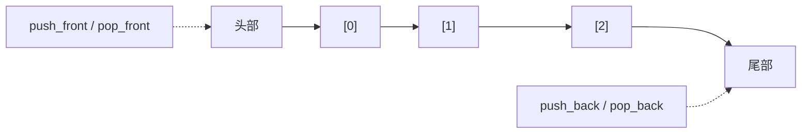

# STL 容器笔记：`deque`

> 参考源码：[deque容器.cpp](../code/STL/deque容器.cpp)、[deque容器数据操作.cpp](../code/STL/deque容器数据操作.cpp)、[deque数据存取.cpp](../code/STL/deque数据存取.cpp)、[deque排序算法.cpp](../code/STL/deque排序算法.cpp)。

## 1. 核心概念

`std::deque`（double-ended queue）是双端队列，支持在头部和尾部高效插入、删除，也支持下标随机访问。它通常由多个内存块组织，不保证所有元素连续存储。

### 结构示意图



## 2. 创建与赋值

```cpp
#include <deque>
std::deque<int> a;
std::deque<int> b{1, 2, 3};
std::deque<int> c(5, 10);
std::deque<int> d(b.begin(), b.end());
```

可使用赋值运算符、`assign`、`swap`，用法与多数序列容器相近。

## 3. 常用数据操作

| 接口 | 作用 |
|---|---|
| `push_back(x)` / `emplace_back(...)` | 尾部添加 |
| `push_front(x)` / `emplace_front(...)` | 头部添加 |
| `pop_back()` | 删除尾部元素 |
| `pop_front()` | 删除头部元素 |
| `insert(pos, x)` | 在迭代器位置前插入 |
| `erase(pos)` / `erase(first,last)` | 删除指定元素 / 区间 |
| `clear()` | 清空 |
| `assign(...)` | 替换全部内容 |
| `resize(n)` / `resize(n,value)` | 改变元素数量 |
| `swap(other)` | 交换内容 |

## 4. 数据访问与容量

| 接口 | 作用 |
|---|---|
| `d[i]` / `d.at(i)` | 随机访问 |
| `front()` / `back()` | 首元素 / 尾元素 |
| `begin()` / `end()` | 迭代器 |
| `size()` / `empty()` | 元素数量 / 是否为空 |

**deque 没有像 vector 那样对外提供 `capacity()` 和 `reserve()` 的接口。** 它的内部存储管理方式不同。

## 5. 示例：双端操作与排序

```cpp
std::deque<int> d{2, 3};
d.push_front(1);
d.push_back(4); // 1 2 3 4
std::sort(d.begin(), d.end()); // deque 支持随机访问迭代器
```

## 6. 复杂度与注意事项

- 两端插入、删除通常为 O(1)。
- 下标访问为 O(1)。
- 中间插入、删除通常需要移动元素。
- 在两端插入/删除时，迭代器可能失效；引用和指针的失效规则与 vector 不同，不能简单套用 vector 规则。
- 不要在空 deque 上调用 `front()`、`back()` 或 `pop_*`。

## 7. 适用场景

既需要头部操作，也需要尾部操作，同时还希望按下标访问时，可以考虑 `deque`。