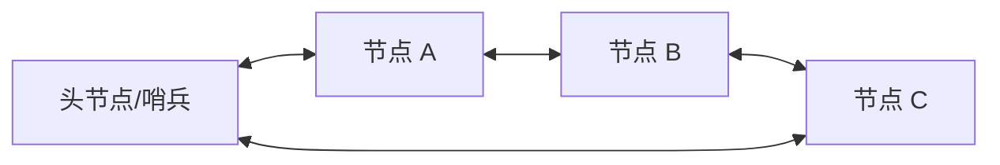

# STL 容器笔记：`list`

> 参考源码：[list容器.cpp](../code/STL/list容器.cpp)。

## 1. 核心概念

`std::list` 是双向链表。每个节点保存数据以及指向前后节点的链接。它不支持下标随机访问，但在已经取得位置迭代器时，插入和删除节点很高效。

### 结构示意图



常见标准库实现采用带哨兵节点的双向链表；不要把某一种内部实现细节当作所有实现必须采用的唯一布局。

## 2. 创建与赋值

```cpp
#include <list>
std::list<int> a;
std::list<int> b{3, 1, 2};
std::list<int> c(4, 10);
std::list<int> d(b.begin(), b.end());
```

支持赋值、`assign`、`swap` 等操作。

## 3. 常用数据操作

| 接口 | 作用 |
|---|---|
| `push_back(x)` / `emplace_back(...)` | 尾部添加 |
| `push_front(x)` / `emplace_front(...)` | 头部添加 |
| `pop_back()` / `pop_front()` | 删除尾部 / 头部 |
| `insert(pos, x)` | 在 pos 前插入节点 |
| `erase(pos)` / `erase(first,last)` | 删除节点 / 区间 |
| `remove(value)` | 删除所有等于 value 的元素 |
| `remove_if(pred)` | 删除满足条件的元素 |
| `unique()` | 删除连续相邻的重复元素 |
| `clear()` | 清空 |
| `resize(n)` | 改变元素数量 |
| `splice(pos, other)` | 将另一个 list 的节点转移到 pos 前 |
| `swap(other)` | 交换内容 |

## 4. list 的专属算法成员

| 成员函数 | 效果 |
|---|---|
| `sort()` | 对链表排序 |
| `sort(comp)` | 按自定义比较规则排序 |
| `reverse()` | 反转节点顺序 |
| `merge(other)` | 合并两个已排序链表 |
| `remove(value)` | 按值删除节点 |
| `unique()` | 删除相邻重复元素 |

`list` 不能直接使用 `std::sort(list.begin(), list.end())`，因为它的迭代器不是随机访问迭代器；应使用 `list.sort()`。

## 5. 访问方式

支持 `front()`、`back()`、`begin()`、`end()`、`size()`、`empty()`。不支持 `operator[]`、`at()`，不能通过下标直接访问第 n 个元素。

```cpp
for (auto it = values.begin(); it != values.end(); ++it)
    std::cout << *it << ' ';
```

## 6. 复杂度与易错点

- 已知位置的插入、删除：通常 O(1)。
- 按值查找：O(n)。
- 随机访问第 n 个元素：需要从头或尾遍历，O(n)。
- 插入通常不会使其他元素的迭代器和引用失效；删除只使被删节点的迭代器和引用失效。
- `unique()` 只处理相邻重复值；若要全局去重，可先 `sort()` 再 `unique()`。
- list 的 `remove(value)` 会真正删除匹配节点；这与通用算法 `std::remove` 不同。

## 7. 适用场景

需要频繁在已知位置插入、删除，且不依赖下标访问时可考虑 `list`。若主要是遍历和随机访问，通常优先考虑 `vector`。