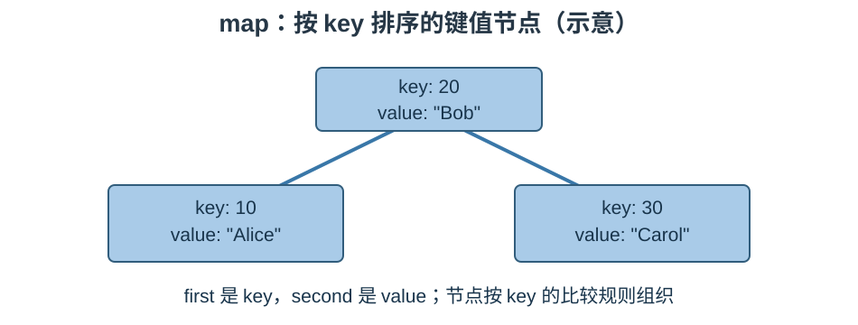

# STL 容器笔记：`map` 与 `multimap`

> 参考源码：[map容器.cpp](../code/STL/map容器.cpp)、[pair对组.cpp](../code/STL/pair对组.cpp)。

## 1. 核心概念

`std::map` 保存键值对（key-value），通过 key 查找 value。map 的键唯一，并按键的比较规则自动排序；multimap 允许重复键。每个 map 元素的类型是类似 `std::pair<const Key, T>` 的键值对。

### 结构示意图



## 2. 创建与插入

```cpp
#include <map>
#include <string>
std::map<std::string, int> scores;
scores.insert(std::make_pair(std::string("Alice"), 95));
scores.emplace("Bob", 88);
scores["Cindy"] = 92;
```

map 中元素可通过 `first` 读取键、`second` 读取值：

```cpp
for (const auto& item : scores)
    std::cout << item.first << ": " << item.second << '\\n';
```

## 3. 常用数据操作

| 接口 | 作用 |
|---|---|
| `insert(pair)` | 插入键值对，键已存在时不覆盖 |
| `emplace(key,value)` | 原位构造元素 |
| `operator[](key)` | 访问值；键不存在时会插入默认构造的 mapped value |
| `at(key)` | 访问已有键；不存在时抛出 `std::out_of_range` |
| `find(key)` | 查找键，未找到返回 end |
| `count(key)` | 统计键数量；map 中只可能为 0 或 1 |
| `erase(key/pos/range)` | 按键、位置或区间删除 |
| `clear()` | 清空 |
| `size()` / `empty()` | 元素数量 / 是否为空 |
| `lower_bound(key)` / `upper_bound(key)` | 查找键的有序边界 |
| `swap(other)` | 交换 |

## 4. `operator[]` 与 `at()` 的关键区别

```cpp
std::map<std::string, int> m;
m["Tom"] = 90;       // 没有 Tom 时先插入，int 值初始化为 0，再赋值 90
int score = m["Amy"]; // Amy 不存在时也会插入 Amy，值为 0

int x = m.at("Tom"); // 只访问已有键
// m.at("Nobody");   // 键不存在时抛出 std::out_of_range
```

只想查找而不想插入时，优先使用 `find()` 或 `at()`。

## 5. map 与 multimap

- `map`：key 唯一；支持 `operator[]` 和 `at()`。
- `multimap`：允许重复 key；不提供 `operator[]` 和 `at()`，可用 `equal_range()` 获取同一 key 的元素范围。

## 6. 复杂度与易错点

- 查找、插入、删除通常为 O(log n)。
- map 中的 key 是 const，不能通过迭代器直接修改 key。
- `insert` 遇到已存在的 key 不会覆盖旧值；需要更新时可使用 `operator[]` 或其他赋值方式。
- `operator[]` 可能意外插入元素，尤其是在只读查询代码中要留意。
- 遍历顺序由 key 的比较规则决定，不是插入顺序。

## 7. 适用场景

需要通过唯一键查找关联数据，并希望键始终有序时使用 map，例如学号到成绩、名称到对象、配置项到参数的映射。