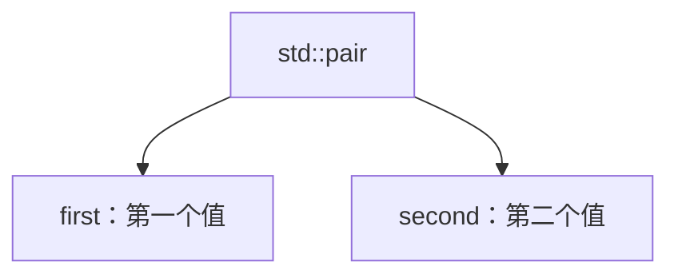

# STL 工具类型笔记：`pair`

> 参考源码：[pair对组.cpp](../code/STL/pair对组.cpp)。`pair` 是标准库工具类型，不是容器。

## 1. 核心概念

`std::pair<T1,T2>` 把两个可能不同类型的值组合成一个对象。两个成员分别叫 `first` 和 `second`。

### 结构示意图



## 2. 创建方式

```cpp
#include <utility>
#include <string>

std::pair<std::string, int> p("Alice", 95);
auto q = std::make_pair(std::string("Bob"), 88);
std::pair<std::string, int> r{"Cindy", 92};
```

## 3. 常用操作

| 操作 | 作用 |
|---|---|
| `p.first` | 访问第一个成员 |
| `p.second` | 访问第二个成员 |
| `std::make_pair(a,b)` | 根据参数推导类型并创建 pair |
| `p = q` | 同类型或可兼容类型的赋值 |
| `std::swap(p,q)` | 交换两个 pair |
| `p == q`、`p < q` | 按成员顺序进行比较（需成员类型支持比较） |

## 4. pair 与 map

map 的每个元素都是键值对，概念上可按 `pair<const Key, T>` 理解：

- `first` 对应 key；
- `second` 对应 value。

```cpp
std::map<int, std::string> names;
names.insert(std::make_pair(1, "Alice"));
```

set 插入返回值也是一个 pair：迭代器和 bool 状态。

## 5. 易错点

1. pair 只有两个成员，不负责管理一组可增长的数据，因此不是容器。
2. 成员名固定为 `first`、`second`。
3. pair 的比较通常先比较 first；first 相等时再比较 second。
4. 使用时包含头文件 `<utility>`；map 自身也会用到 pair。
