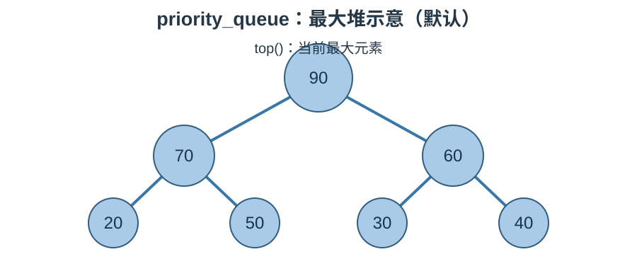

# STL 容器适配器笔记：`priority_queue`

## 1. 核心概念

`std::priority_queue` 是优先队列。它不像普通 queue 那样严格按进入顺序出队，而是让当前优先级最高的元素先被访问。默认情况下，数值最大的元素优先，表现为最大堆。

### 结构示意图



这是堆的逻辑关系示意，不代表底层元素按树形连续存放。

## 2. 创建与常用操作

```cpp
#include <queue>
#include <vector>
#include <functional>

std::priority_queue<int> max_heap; // 默认最大堆
max_heap.push(10);
max_heap.push(30);
max_heap.push(20);
std::cout << max_heap.top(); // 30
max_heap.pop();

std::priority_queue<int, std::vector<int>, std::greater<int>> min_heap;
```

| 接口 | 作用 |
|---|---|
| `push(value)` | 插入元素并维护堆 |
| `emplace(args...)` | 原位构造并插入 |
| `top()` | 访问优先级最高的元素 |
| `pop()` | 删除堆顶，不返回值 |
| `empty()` | 判断是否为空 |
| `size()` | 元素数量 |
| `swap(other)` | 交换两个优先队列 |

## 3. 最大堆与最小堆

- `std::priority_queue<int>`：默认最大堆，`top()` 是最大值。
- `std::priority_queue<int, std::vector<int>, std::greater<int>>`：最小堆，`top()` 是最小值。

## 4. 自定义类型

自定义类型需要提供可用的比较规则。比较器必须满足严格弱序要求；编写时要明确“谁应该排在 top”。

```cpp
struct Task {
    int priority;
    int id;
};
struct Compare {
    bool operator()(const Task& a, const Task& b) const {
        return a.priority < b.priority; // priority 较小的优先级较低
    }
};
std::priority_queue<Task, std::vector<Task>, Compare> tasks;
```

## 5. 易错点与适用场景

1. `pop()` 不返回堆顶元素，先读取 `top()`。
2. 空队列不能调用 `top()` 或 `pop()`。
3. 不能直接遍历 priority_queue 的内部元素；可反复读取 top 并 pop，但这会清空队列。
4. 适合任务优先级调度、Top K、合并有序数据、图算法中的优先选择等场景。