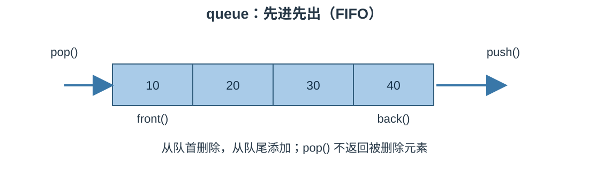

# STL 容器适配器笔记：`queue`

> 参考源码：[queue容器.cpp](../code/STL/queue容器.cpp)。

## 1. 核心概念

`std::queue` 是容器适配器，采用先进先出（FIFO, First In First Out）：先进入队列的元素先离开。只能访问队首和队尾，不支持遍历或随机访问。

### 结构示意图



## 2. 创建与常用操作

```cpp
#include <queue>
std::queue<int> q;
q.push(10);
q.push(20);
q.push(30);

std::cout << q.front(); // 10
std::cout << q.back();  // 30
q.pop();                // 删除 10
```

| 接口 | 作用 |
|---|---|
| `push(value)` | 从队尾添加元素 |
| `emplace(args...)` | 在队尾原位构造元素 |
| `front()` | 访问队首元素 |
| `back()` | 访问队尾元素 |
| `pop()` | 删除队首元素，不返回值 |
| `empty()` | 判断是否为空 |
| `size()` | 返回元素数量 |
| `swap(other)` | 交换两个队列 |

默认底层容器通常为 `deque`。也可使用符合要求的其他底层容器，例如 `std::list`。

## 3. 遍历队列

queue 不提供迭代器。若要依次处理全部元素，通常通过队首读取并弹出：

```cpp
while (!q.empty()) {
    const auto& value = q.front();
    std::cout << value << '\\n';
    q.pop();
}
```

注意：上述过程会消耗原队列。如果还要保留原队列，可以先复制一份再处理。

## 4. 易错点

1. `pop()` 只删除队首，不返回元素。
2. 空队列不能调用 `front()`、`back()` 或 `pop()`。
3. queue 不能通过下标访问，也不能直接用范围 for 遍历。
4. FIFO 是“先入先出”，不要与 stack 的 LIFO 混淆。

## 5. 适用场景

排队系统、任务调度、消息缓冲、广度优先搜索（BFS）等需要按到达顺序处理的场景。