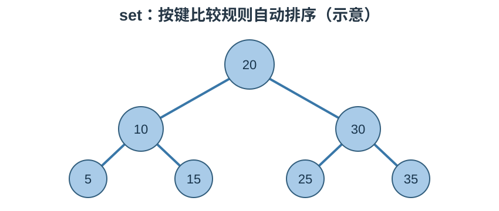

# STL 容器笔记：`set` 与 `multiset`

> 参考源码：[set_multiset容器.cpp](../code/STL/set_multiset容器.cpp)、[set排序.cpp](../code/STL/set排序.cpp)。

## 1. 核心概念

`std::set` 和 `std::multiset` 是有序关联容器，按键的比较规则自动维护顺序。set 不允许重复键，multiset 允许重复键。通常基于平衡搜索树实现。

### 结构示意图



示意图表达搜索树的有序关系；具体树形会随插入和删除自动调整。

## 2. 创建与插入

```cpp
#include <set>
std::set<int> s{3, 1, 2, 2};      // 实际元素为 1,2,3
std::multiset<int> ms{3, 1, 2, 2}; // 保留重复的 2

s.insert(4);
auto result = s.insert(2); // pair<iterator,bool>，bool 表示是否成功插入
```

## 3. 常用数据操作

| 接口 | 作用 |
|---|---|
| `insert(value)` | 插入元素；set 重复键不会新增 |
| `emplace(args...)` | 原位构造元素 |
| `erase(key)` | 按键删除；multiset 会删除所有匹配键 |
| `erase(pos)` | 删除迭代器指向的元素 |
| `erase(first,last)` | 删除迭代器区间 |
| `clear()` | 清空 |
| `swap(other)` | 交换 |
| `find(key)` | 查找键，未找到返回 end |
| `count(key)` | 统计匹配键数量 |
| `lower_bound(key)` | 首个不小于 key 的位置 |
| `upper_bound(key)` | 首个大于 key 的位置 |
| `equal_range(key)` | 返回匹配键范围 |

## 4. 遍历与排序规则

```cpp
for (const auto& value : s)
    std::cout << value << ' '; // 按比较规则的顺序输出
```

默认升序。自定义类型需要提供比较规则，例如比较器函数对象：

```cpp
struct Compare {
    bool operator()(int a, int b) const {
        return a > b; // 降序
    }
};
std::set<int, Compare> descending;
```

比较器应建立严格弱序关系。不要用 `<=` 代替 `<` 作为普通升序比较器。

## 5. 复杂度与易错点

- 查找、插入、删除通常为 O(log n)。
- set 元素的键不能通过迭代器修改，否则会破坏容器顺序。
- set 的 `insert` 返回 pair；`second` 为 true 表示新键插入成功。
- `multiset::count(key)` 可能返回大于 1 的数量。
- set/map 的迭代器是双向迭代器，不能使用 `it + 1`。

## 6. 适用场景

需要自动排序、快速按键查找，或需要维护不重复元素集合时使用 set；允许重复键时使用 multiset。