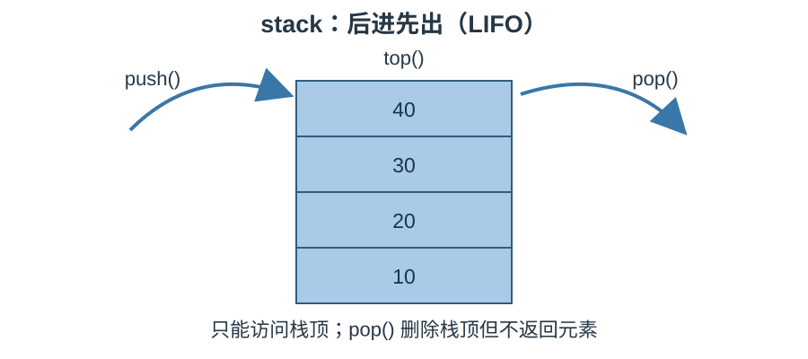

# STL 容器适配器笔记：`stack`

> 参考源码：[stack容器.cpp](../code/STL/stack容器.cpp)。

## 1. 核心概念

`std::stack` 是容器适配器，提供后进先出（LIFO, Last In First Out）的访问规则：最后放入的元素最先取出。只能访问栈顶，不能遍历或按下标访问。

### 结构示意图




> 原图出处：Cui Jiacai，《C++ STL Tutorial》「[stack - 栈](https://cui-jiacai.gitbook.io/c++-stl-tutorial/rong-qi-container/stack-zhan)」章节。

## 2. 创建

```cpp
#include <stack>
std::stack<int> s;
std::stack<int> other;
```

默认底层容器通常是 `deque`，也可以指定满足要求的底层容器，例如 `std::stack<int, std::vector<int>>`。

## 3. 常用操作

| 接口 | 作用 |
|---|---|
| `push(value)` | 将元素压入栈顶 |
| `emplace(args...)` | 在栈顶原位构造元素 |
| `top()` | 访问栈顶元素（引用） |
| `pop()` | 删除栈顶元素，不返回值 |
| `empty()` | 判断是否为空 |
| `size()` | 返回元素数量 |
| `swap(other)` | 交换两个栈 |

## 4. 正确读取并弹出

```cpp
while (!s.empty()) {
    int value = s.top(); // 先读取
    std::cout << value << '\\n';
    s.pop();             // 再删除
}
```

## 5. 易错点

1. `pop()` 不会返回被删除的元素；先用 `top()` 读取。
2. 空栈调用 `top()` 或 `pop()` 是错误的，先判断 `empty()`。
3. stack 不提供迭代器，不能用范围 for 遍历。
4. 栈的访问顺序与 queue 相反。

## 6. 适用场景

函数调用栈、撤销操作、括号匹配、深度优先搜索、表达式求值等具有“后进先出”特征的问题。