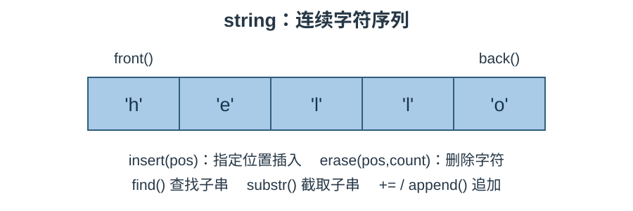

# STL 字符串笔记：`string`

> 参考源码：[string容器.cpp](../code/STL/string容器.cpp)。

## 1. 核心概念

`std::string` 是管理字符序列的类，常用于保存和修改文本。它会自动管理内存，不需要像 C 风格字符串那样手动维护字符数组结尾的 '\0'。

### 结构示意图



## 2. 创建与赋值

```cpp
#include <string>
std::string a;                 // 空字符串
std::string b = "hello";       // C 风格字符串构造
std::string c(b);              // 拷贝构造
std::string d(5, 'a');         // "aaaaa"
std::string e("abcdef", 3);    // "abc"
```

| 接口 | 作用 |
|---|---|
| `operator=` | 使用另一个字符串、字符或 C 字符串赋值 |
| `assign(str)` | 使用字符串内容赋值 |
| `assign(str, n)` | 赋值前 n 个字符 |
| `assign(n, ch)` | 赋值 n 个指定字符 |
| `assign(first,last)` | 使用迭代器区间赋值 |

## 3. 常用数据操作

| 接口 | 作用 |
|---|---|
| `+=` / `append()` | 追加字符串或字符 |
| `push_back(ch)` | 末尾追加一个字符 |
| `pop_back()` | 删除末尾字符，不返回值 |
| `insert(pos, str)` | 在指定位置插入 |
| `erase(pos, count)` | 从位置 pos 删除 count 个字符 |
| `replace(pos, count, str)` | 替换指定区间 |
| `clear()` | 清空字符串 |
| `swap(other)` | 交换两个字符串 |

## 4. 查找、截取与访问

| 接口 | 作用 |
|---|---|
| `find(str, pos)` | 从 pos 开始查找，返回首次匹配位置 |
| `rfind(str)` | 从后向前查找 |
| `substr(pos, count)` | 截取子串并返回新 string |
| `s[i]` | 下标访问，不检查边界 |
| `at(i)` | 下标访问，检查边界 |
| `front()` / `back()` | 首字符 / 尾字符 |
| `c_str()` | 获取以 '\0' 结尾的只读 C 字符串指针 |

`find` 未找到时返回 `std::string::npos`：

```cpp
std::string s = "hello world";
auto pos = s.find("world");
if (pos != std::string::npos)
    std::cout << s.substr(pos, 5);
```

## 5. 大小与遍历

- `size()` / `length()`：字符元素数量，二者等价。
- `empty()`：是否为空。
- `capacity()`：当前容量。
- `reserve(n)`：预留容量。
- `resize(n)`：改变字符数量。
- `begin()` / `end()`：迭代器范围。

```cpp
for (char ch : s) std::cout << ch << ' ';
```

## 6. 易错点

1. `find` 返回的是位置，不是迭代器；未找到要与 `npos` 比较。
2. `substr(pos, count)` 的第二个参数是长度，不是结束下标。
3. `erase(pos, count)` 的第二个参数也是删除数量。
4. `size()` 统计 char 元素数量，不等于中文字符数或屏幕显示宽度。UTF-8 中文通常由多个字节组成。
5. 修改字符串可能导致原有指针、引用和迭代器失效。

## 7. 适用场景

保存文本、拼接内容、搜索关键字、截取字段、替换文本时使用 `std::string`。