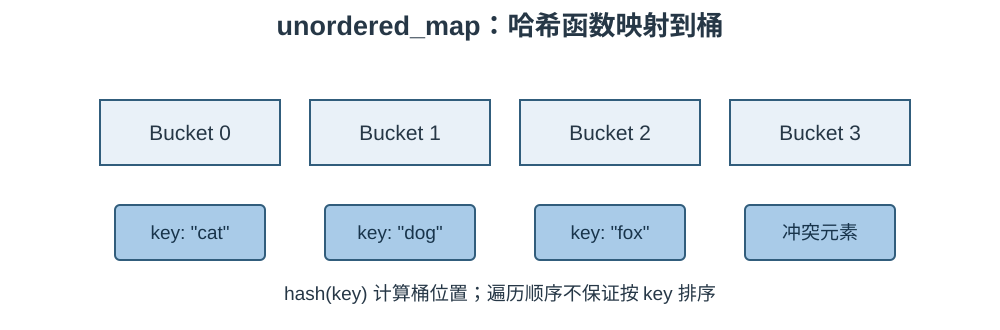

# STL 容器笔记：无序关联容器

## 1. 核心概念

无序关联容器主要包括 `std::unordered_set`、`std::unordered_multiset`、`std::unordered_map` 和 `std::unordered_multimap`。它们基于哈希表组织数据，不按键大小排序，也不保证遍历顺序。

### 结构示意图

不同实现处理桶内冲突的方式可能不同；学习重点是哈希函数把键映射到桶，冲突时需要进一步比较键。

## 2. 四种类型

| 容器 | 保存内容 | 是否允许重复键 |
|---|---|---|
| `unordered_set` | 键 | 否 |
| `unordered_multiset` | 键 | 是 |
| `unordered_map` | 键值对 | 否 |
| `unordered_multimap` | 键值对 | 是 |

## 3. 常用操作

这些容器的常见操作与 set/map 类似：

| 接口 | 作用 |
|---|---|
| `insert` / `emplace` | 插入元素 |
| `erase` | 删除元素 |
| `find(key)` | 查找键 |
| `count(key)` | 统计匹配数量 |
| `clear()` | 清空 |
| `size()` / `empty()` | 数量 / 是否为空 |
| `begin()` / `end()` | 遍历 |
| `bucket_count()` | 当前桶数量 |
| `load_factor()` | 当前负载因子 |
| `max_load_factor()` | 最大负载因子设置/读取 |
| `reserve(n)` | 为预计元素数量预留桶容量 |
| `rehash(n)` | 请求调整桶数量 |

`unordered_map` 还支持 `operator[]` 和 `at()`，其语义与 map 类似：`operator[]` 在 key 不存在时会插入。

## 4. 复杂度与哈希规则

- 查找、插入、删除平均通常为 O(1)。
- 哈希冲突严重时，最坏情况可能退化到 O(n)。
- 自定义键类型通常需要提供哈希函数和相等比较规则。
- 若两个键相等，它们必须产生相同的哈希值。
- rehash 可能改变桶布局和遍历顺序，并使迭代器失效。

## 5. 有序与无序容器怎么选

| 需求 | 建议 |
|---|---|
| 需要按键排序 | `map` / `set` |
| 只需要快速按键查找，不关心顺序 | `unordered_map` / `unordered_set` |
| 需要重复键并保持排序 | `multimap` / `multiset` |
| 需要重复键且不关心顺序 | `unordered_multimap` / `unordered_multiset` |

## 6. 易错点

1. 不要依赖无序容器的遍历顺序。
2. 平均 O(1) 不等于任何情况下都保证 O(1)。
3. 修改容器可能触发 rehash，注意迭代器失效。
4. 哈希函数与相等比较必须保持一致。
