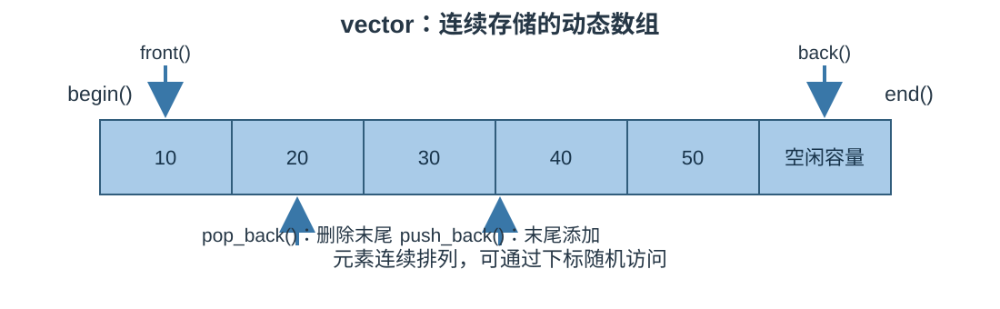

# STL 容器笔记：`vector`

> 参考源码：[vector容器.cpp](../code/STL/vector容器.cpp)、[vector容器数据操作.cpp](../code/STL/vector容器数据操作.cpp)、[vector容器数据存取.cpp](../code/STL/vector容器数据存取.cpp)、[vector容器容量和大小.cpp](../code/STL/vector容器容量和大小.cpp)、[vector预留空间.cpp](../code/STL/vector预留空间.cpp)、[vector容器互换.cpp](../code/STL/vector容器互换.cpp)。

## 1. 核心概念

`std::vector<T>` 是动态数组，元素连续存储。它可以在运行时改变长度，并支持常数时间随机访问。尾部追加通常是摊还 O(1)，中间插入或删除需要移动后续元素。

### 结构示意图




<text></text>

> 原图出处：Cui Jiacai，《C++ STL Tutorial》「[vector - 向量](https://cui-jiacai.gitbook.io/c++-stl-tutorial/rong-qi-container/vector-xiang-liang)」章节。

可把它理解为一排连续编号的格子。下标从 0 开始，元素之间没有链表节点指针。

## 2. 创建与初始化

```cpp
#include <vector>
std::vector<int> a;                 // 空容器
std::vector<int> b{1, 2, 3};        // 初始化列表
std::vector<int> c(5);              // 5 个值初始化的 int（均为 0）
std::vector<int> d(5, 10);          // 5 个 10
std::vector<int> e(b.begin(), b.end()); // 迭代器区间构造
```

## 3. 常用数据操作

| 接口 | 作用 | 注意事项 |
|---|---|---|
| `push_back(x)` | 在末尾添加元素 | 可能触发扩容 |
| `emplace_back(args...)` | 在末尾原位构造元素 | 适合直接传构造参数 |
| `pop_back()` | 删除末尾元素 | 不返回被删除的值；空容器不能调用 |
| `insert(pos, x)` | 在迭代器位置前插入 | 返回指向新元素的迭代器 |
| `insert(pos, n, x)` | 在位置前插入 n 个 x | 中间插入会移动元素 |
| `erase(pos)` | 删除指定位置元素 | 返回删除位置之后的迭代器 |
| `erase(first, last)` | 删除半开区间 `[first,last)` | 不包含 last |
| `clear()` | 删除全部元素 | size 变为 0，capacity 通常不变 |
| `assign(n, x)` | 用 n 个 x 替换原内容 | 会覆盖原有元素 |
| `assign(first,last)` | 用迭代器区间替换内容 | 区间不能来自已失效迭代器 |

## 4. 数据访问与遍历

| 接口 | 作用 |
|---|---|
| `v[i]` | 下标访问，不做边界检查 |
| `v.at(i)` | 下标访问，越界时抛出 `std::out_of_range` |
| `front()` / `back()` | 访问首元素 / 尾元素 |
| `begin()` / `end()` | 首元素迭代器 / 尾后迭代器 |
| `data()` | 获取连续存储区首元素指针（非空时） |

```cpp
for (auto it = v.begin(); it != v.end(); ++it)
    std::cout << *it << ' ';

for (const auto& value : v)
    std::cout << value << ' ';
```

## 5. 大小与容量：重点区别

| 接口 | 含义 |
|---|---|
| `size()` | 当前实际元素数量 |
| `capacity()` | 当前已分配空间可容纳的元素数量 |
| `empty()` | 是否没有元素 |
| `reserve(n)` | 至少预留 n 个元素的容量，不改变 size |
| `resize(n)` | 把 size 改成 n；变大时创建新元素，变小时删除尾部元素 |
| `shrink_to_fit()` | 请求减少多余容量；不保证一定收缩 |

```cpp
std::vector<int> v;
v.reserve(5); // size()==0，不能因此访问 v[0]
v.resize(5);  // size()==5，新增 int 元素值为 0
```

## 6. 交换与典型示例

```cpp
std::vector<int> a{1, 2, 3};
std::vector<int> b{8, 9};
a.swap(b);             // 交换两者内容
std::swap(a, b);       // 也可使用通用 swap
```

## 7. 复杂度与迭代器失效

- 下标访问：O(1)。
- 尾部追加：摊还 O(1)，扩容时可能搬迁全部元素。
- 中间插入/删除：通常 O(n)。
- 扩容重新分配内存时，指向原元素的指针、引用和迭代器全部失效。
- 未发生扩容时，中间插入/删除也会使插入/删除点及其后的迭代器失效。

## 8. 易错点

1. `reserve(10)` 不是创建 10 个元素；此时 `size()` 仍可能为 0。
2. `pop_back()` 只删除，不返回值。
3. `erase` 的区间是左闭右开。
4. 插入或删除后，检查并更新迭代器，不要继续使用可能失效的旧迭代器。
5. 不要在空 vector 上调用 `front()`、`back()` 或 `pop_back()`。

## 9. 适用场景

需要频繁按下标读取、主要在末尾追加、希望数据连续存储时，优先考虑 `vector`。